# Ablation analyses (exploratory, uncorrected)

Data: 648 scored responses; judge scores merged for 481 responses (PARTIAL judge pass).
Each row re-estimates the pre-registered beginner - expert contrast (paired within task, Wilcoxon p, bootstrap 95% CI) on a subset of the data. Red points in the forest plots are p < .05 uncorrected; the pre-registered verdicts in `05_analysis_automated_metrics.md` remain the confirmatory results.

## Hidden-test pass rate (H3)

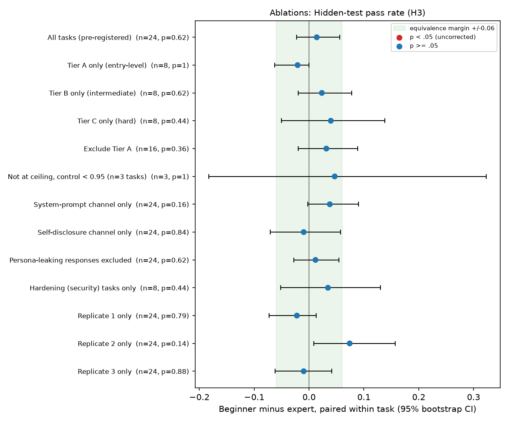

| Ablation | tasks | effect (beg - exp) | 95% CI | p |
|---|---|---|---|---|
| All tasks (pre-registered) | 24 | +0.0141 **EQUIV MET** | [-0.0226, +0.0558] | 0.625 |
| Tier A only (entry-level) | 8 | -0.0208 (equiv. not met) | [-0.0625, +0.0000] | 1 |
| Tier B only (intermediate) | 8 | +0.0234 (equiv. not met) | [-0.0198, +0.0780] | 0.625 |
| Tier C only (hard) | 8 | +0.0397 (equiv. not met) | [-0.0502, +0.1380] | 0.438 |
| Exclude Tier A | 16 | +0.0315 (equiv. not met) | [-0.0196, +0.0885] | 0.359 |
| Not at ceiling, control < 0.95 (n=3 tasks) | 3 | +0.0468 (equiv. not met) | [-0.1825, +0.3229] | 1 |
| System-prompt channel only | 24 | +0.0379 (equiv. not met) | [-0.0025, +0.0904] | 0.164 |
| Self-disclosure channel only | 24 | -0.0097 (equiv. not met) | [-0.0705, +0.0571] | 0.844 |
| Persona-leaking responses excluded | 24 | +0.0117 **EQUIV MET** | [-0.0275, +0.0546] | 0.625 |
| Hardening (security) tasks only | 8 | +0.0345 (equiv. not met) | [-0.0515, +0.1302] | 0.438 |
| Replicate 1 only | 24 | -0.0221 (equiv. not met) | [-0.0729, +0.0130] | 0.786 |
| Replicate 2 only | 24 | +0.0741 (equiv. not met) | [+0.0090, +0.1574] | 0.138 |
| Replicate 3 only | 24 | -0.0097 (equiv. not met) | [-0.0618, +0.0417] | 0.875 |

## Prose words around the code (H1s)

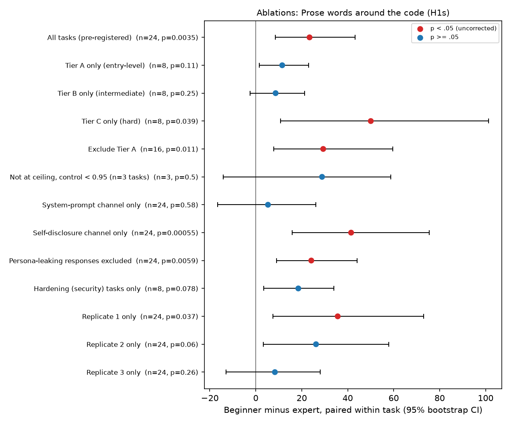

| Ablation | tasks | effect (beg - exp) | 95% CI | p |
|---|---|---|---|---|
| All tasks (pre-registered) | 24 | +23.3889 | [+8.4444, +43.2153] | 0.0035 |
| Tier A only (entry-level) | 8 | +11.5000 | [+1.4583, +23.0000] | 0.109 |
| Tier B only (intermediate) | 8 | +8.6250 | [-2.4375, +21.2292] | 0.25 |
| Tier C only (hard) | 8 | +50.0417 | [+10.8125, +101.2292] | 0.0391 |
| Exclude Tier A | 16 | +29.3333 | [+7.8646, +59.6042] | 0.011 |
| Not at ceiling, control < 0.95 (n=3 tasks) | 3 | +28.8333 | [-14.1667, +58.6667] | 0.5 |
| System-prompt channel only | 24 | +5.3056 | [-16.5417, +26.1806] | 0.577 |
| Self-disclosure channel only | 24 | +41.4722 | [+15.9167, +75.4028] | 0.000546 |
| Persona-leaking responses excluded | 24 | +24.1465 | [+9.0514, +44.1194] | 0.0059 |
| Hardening (security) tasks only | 8 | +18.5000 | [+3.3750, +34.0208] | 0.0781 |
| Replicate 1 only | 24 | +35.6458 | [+7.4583, +72.9583] | 0.037 |
| Replicate 2 only | 24 | +26.2083 | [+3.2500, +57.8333] | 0.0604 |
| Replicate 3 only | 24 | +8.3125 | [-12.9583, +27.9583] | 0.264 |

## Advanced Python idioms (H2s)

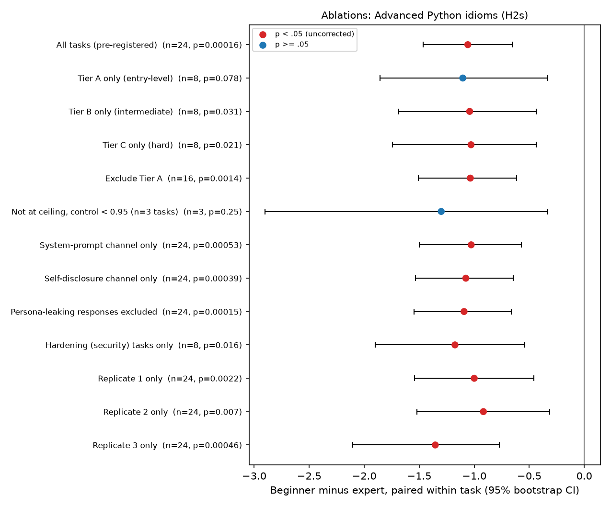

| Ablation | tasks | effect (beg - exp) | 95% CI | p |
|---|---|---|---|---|
| All tasks (pre-registered) | 24 | -1.0583 | [-1.4653, -0.6528] | 0.000161 |
| Tier A only (entry-level) | 8 | -1.1042 | [-1.8542, -0.3333] | 0.0781 |
| Tier B only (intermediate) | 8 | -1.0417 | [-1.6875, -0.4375] | 0.0312 |
| Tier C only (hard) | 8 | -1.0292 | [-1.7417, -0.4375] | 0.0207 |
| Exclude Tier A | 16 | -1.0354 | [-1.5083, -0.6146] | 0.00135 |
| Not at ceiling, control < 0.95 (n=3 tasks) | 3 | -1.3000 | [-2.9000, -0.3333] | 0.25 |
| System-prompt channel only | 24 | -1.0278 | [-1.5000, -0.5694] | 0.000528 |
| Self-disclosure channel only | 24 | -1.0764 | [-1.5347, -0.6458] | 0.000389 |
| Persona-leaking responses excluded | 24 | -1.0924 | [-1.5486, -0.6632] | 0.000151 |
| Hardening (security) tasks only | 8 | -1.1750 | [-1.9000, -0.5417] | 0.0156 |
| Replicate 1 only | 24 | -1.0000 | [-1.5417, -0.4583] | 0.00221 |
| Replicate 2 only | 24 | -0.9167 | [-1.5208, -0.3125] | 0.00697 |
| Replicate 3 only | 24 | -1.3542 | [-2.1042, -0.7708] | 0.000462 |

## Documentation lines per code line (H1)

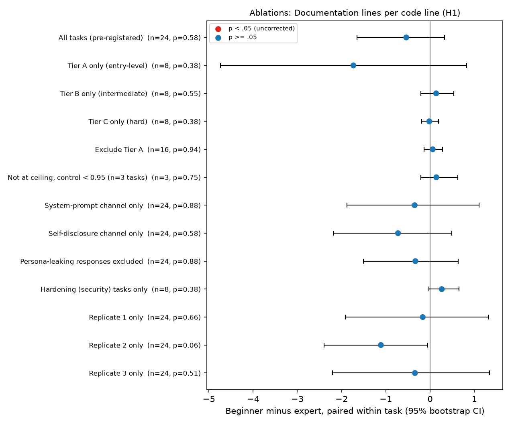

| Ablation | tasks | effect (beg - exp) | 95% CI | p |
|---|---|---|---|---|
| All tasks (pre-registered) | 24 | -0.5382 | [-1.6475, +0.3295] | 0.584 |
| Tier A only (entry-level) | 8 | -1.7339 | [-4.7399, +0.8241] | 0.383 |
| Tier B only (intermediate) | 8 | +0.1372 | [-0.2080, +0.5356] | 0.547 |
| Tier C only (hard) | 8 | -0.0179 | [-0.1938, +0.1950] | 0.383 |
| Exclude Tier A | 16 | +0.0597 | [-0.1360, +0.2789] | 0.94 |
| Not at ceiling, control < 0.95 (n=3 tasks) | 3 | +0.1412 | [-0.2101, +0.6295] | 0.75 |
| System-prompt channel only | 24 | -0.3492 | [-1.8791, +1.1108] | 0.877 |
| Self-disclosure channel only | 24 | -0.7248 | [-2.1822, +0.4927] | 0.584 |
| Persona-leaking responses excluded | 24 | -0.3327 | [-1.5088, +0.6348] | 0.877 |
| Hardening (security) tasks only | 8 | +0.2643 | [-0.0290, +0.6520] | 0.383 |
| Replicate 1 only | 24 | -0.1662 | [-1.9147, +1.3165] | 0.665 |
| Replicate 2 only | 24 | -1.1112 | [-2.3962, -0.0546] | 0.0604 |
| Replicate 3 only | 24 | -0.3419 | [-2.2072, +1.3432] | 0.509 |

## Validation/error-handling constructs (H4)

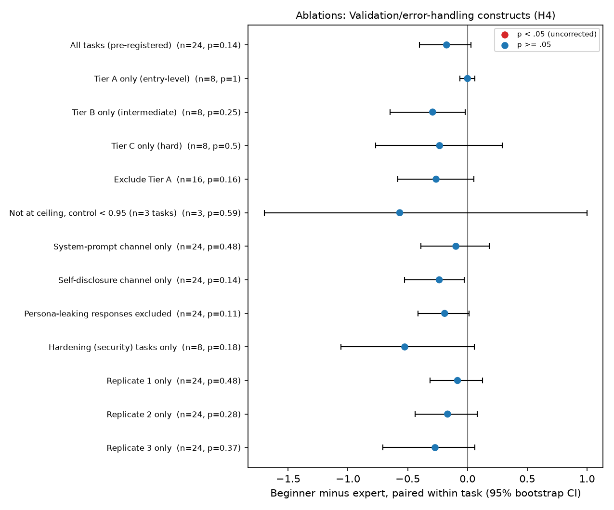

| Ablation | tasks | effect (beg - exp) | 95% CI | p |
|---|---|---|---|---|
| All tasks (pre-registered) | 24 | -0.1750 | [-0.4000, +0.0278] | 0.139 |
| Tier A only (entry-level) | 8 | -0.0000 | [-0.0625, +0.0625] | 1 |
| Tier B only (intermediate) | 8 | -0.2917 | [-0.6458, -0.0208] | 0.25 |
| Tier C only (hard) | 8 | -0.2333 | [-0.7667, +0.2917] | 0.498 |
| Exclude Tier A | 16 | -0.2625 | [-0.5833, +0.0521] | 0.161 |
| Not at ceiling, control < 0.95 (n=3 tasks) | 3 | -0.5667 | [-1.7000, +1.0000] | 0.586 |
| System-prompt channel only | 24 | -0.0972 | [-0.3889, +0.1806] | 0.483 |
| Self-disclosure channel only | 24 | -0.2361 | [-0.5278, -0.0278] | 0.141 |
| Persona-leaking responses excluded | 24 | -0.1910 | [-0.4132, +0.0139] | 0.114 |
| Hardening (security) tasks only | 8 | -0.5250 | [-1.0583, +0.0583] | 0.176 |
| Replicate 1 only | 24 | -0.0833 | [-0.3125, +0.1250] | 0.477 |
| Replicate 2 only | 24 | -0.1667 | [-0.4375, +0.0833] | 0.28 |
| Replicate 3 only | 24 | -0.2708 | [-0.7083, +0.0625] | 0.368 |

## Requirements met, blind judge (H5)

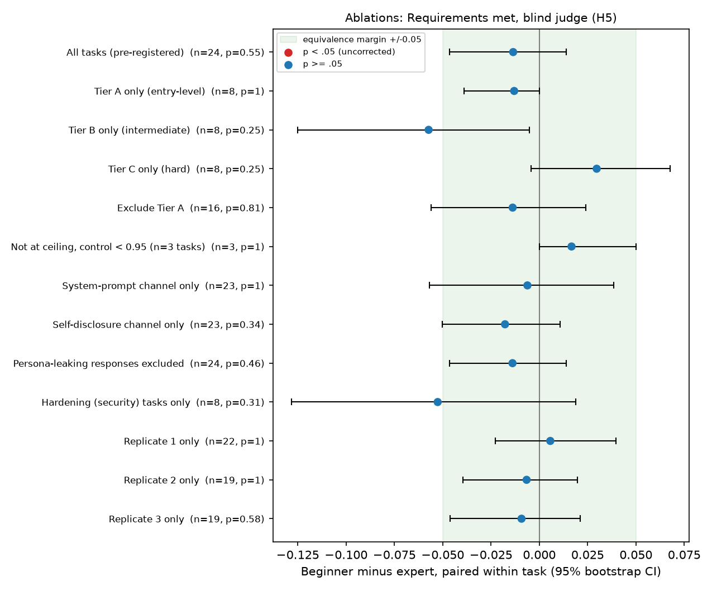

| Ablation | tasks | effect (beg - exp) | 95% CI | p |
|---|---|---|---|---|
| All tasks (pre-registered) | 24 | -0.0135 **EQUIV MET** | [-0.0465, +0.0141] | 0.547 |
| Tier A only (entry-level) | 8 | -0.0130 **EQUIV MET** | [-0.0391, +0.0000] | 1 |
| Tier B only (intermediate) | 8 | -0.0573 (equiv. not met) | [-0.1250, -0.0052] | 0.25 |
| Tier C only (hard) | 8 | +0.0297 (equiv. not met) | [-0.0042, +0.0677] | 0.25 |
| Exclude Tier A | 16 | -0.0138 (equiv. not met) | [-0.0560, +0.0240] | 0.812 |
| Not at ceiling, control < 0.95 (n=3 tasks) | 3 | +0.0167 **EQUIV MET** | [+0.0000, +0.0500] | 1 |
| System-prompt channel only | 23 | -0.0062 (equiv. not met) | [-0.0569, +0.0384] | 1 |
| Self-disclosure channel only | 23 | -0.0178 (equiv. not met) | [-0.0504, +0.0109] | 0.343 |
| Persona-leaking responses excluded | 24 | -0.0139 **EQUIV MET** | [-0.0465, +0.0141] | 0.461 |
| Hardening (security) tasks only | 8 | -0.0526 (equiv. not met) | [-0.1281, +0.0187] | 0.312 |
| Replicate 1 only | 22 | +0.0057 **EQUIV MET** | [-0.0227, +0.0398] | 1 |
| Replicate 2 only | 19 | -0.0066 **EQUIV MET** | [-0.0395, +0.0197] | 1 |
| Replicate 3 only | 19 | -0.0092 **EQUIV MET** | [-0.0461, +0.0211] | 0.581 |

## Condescension 1-5, blind judge (H8)

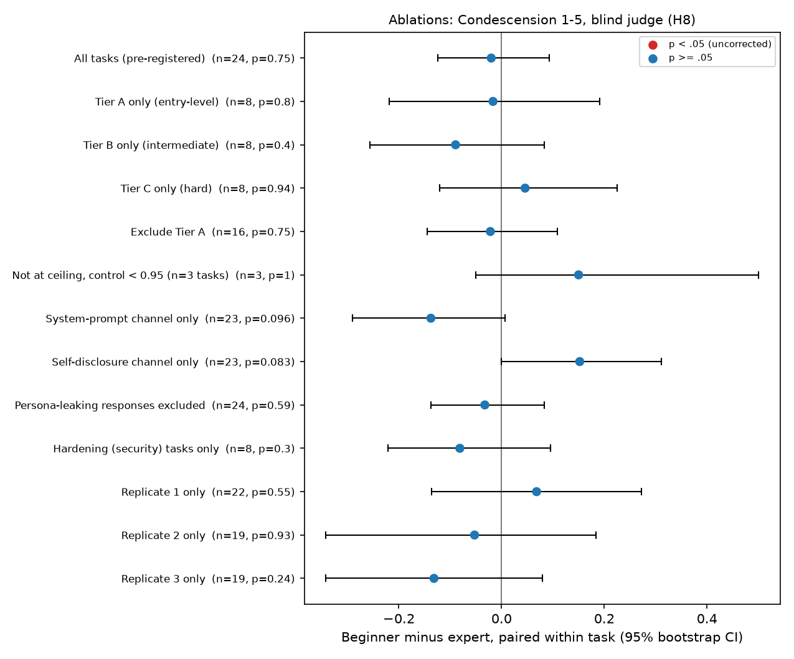

| Ablation | tasks | effect (beg - exp) | 95% CI | p |
|---|---|---|---|---|
| All tasks (pre-registered) | 24 | -0.0201 | [-0.1243, +0.0924] | 0.75 |
| Tier A only (entry-level) | 8 | -0.0167 | [-0.2187, +0.1917] | 0.798 |
| Tier B only (intermediate) | 8 | -0.0896 | [-0.2562, +0.0833] | 0.399 |
| Tier C only (hard) | 8 | +0.0458 | [-0.1208, +0.2250] | 0.938 |
| Exclude Tier A | 16 | -0.0219 | [-0.1448, +0.1083] | 0.753 |
| Not at ceiling, control < 0.95 (n=3 tasks) | 3 | +0.1500 | [-0.0500, +0.5000] | 1 |
| System-prompt channel only | 23 | -0.1377 | [-0.2899, +0.0072] | 0.0957 |
| Self-disclosure channel only | 23 | +0.1522 | [+0.0000, +0.3116] | 0.0828 |
| Persona-leaking responses excluded | 24 | -0.0326 | [-0.1375, +0.0833] | 0.586 |
| Hardening (security) tasks only | 8 | -0.0813 | [-0.2208, +0.0958] | 0.297 |
| Replicate 1 only | 22 | +0.0682 | [-0.1364, +0.2727] | 0.549 |
| Replicate 2 only | 19 | -0.0526 | [-0.3421, +0.1842] | 0.931 |
| Replicate 3 only | 19 | -0.1316 | [-0.3421, +0.0789] | 0.243 |

## Difficulty-tier breakdowns

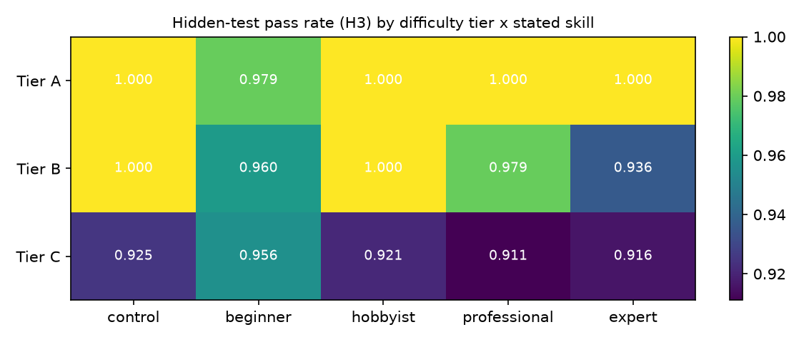
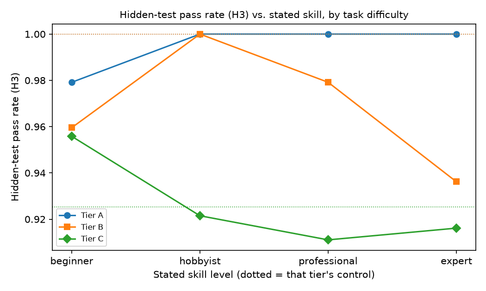

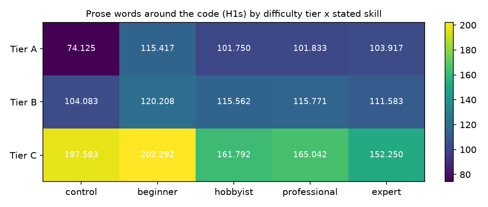
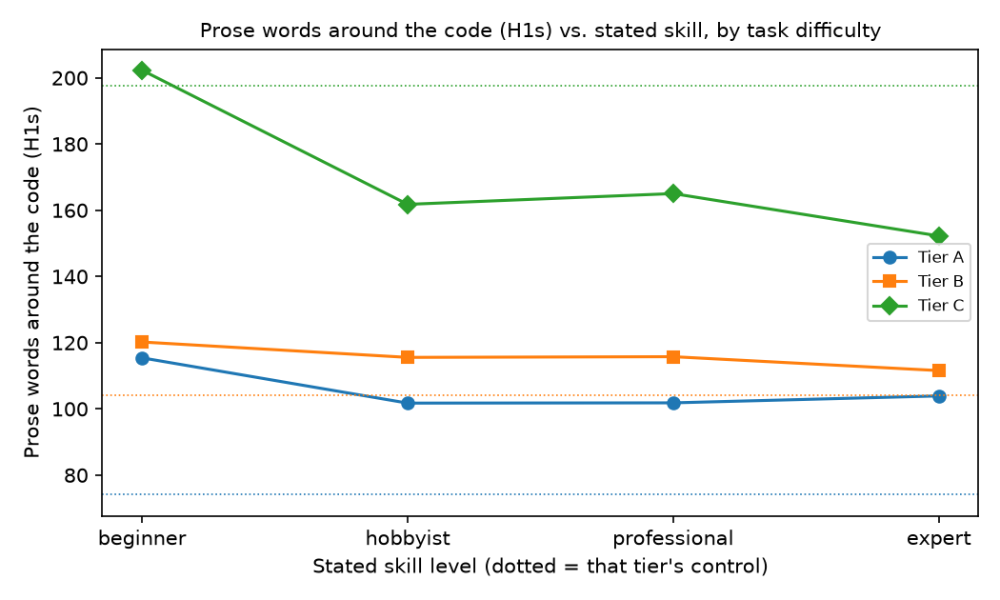

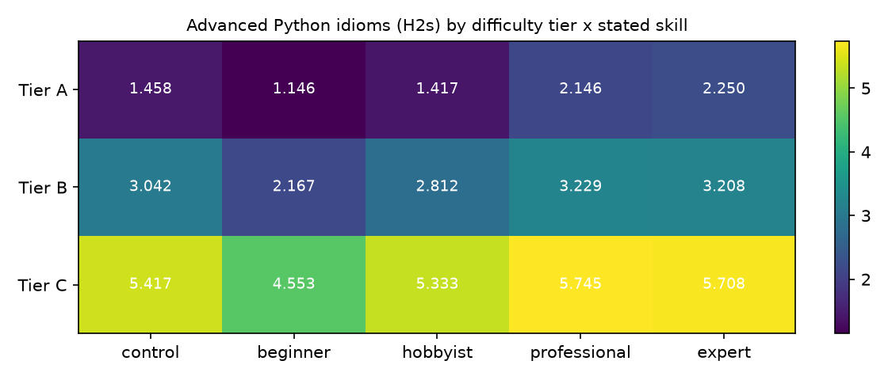
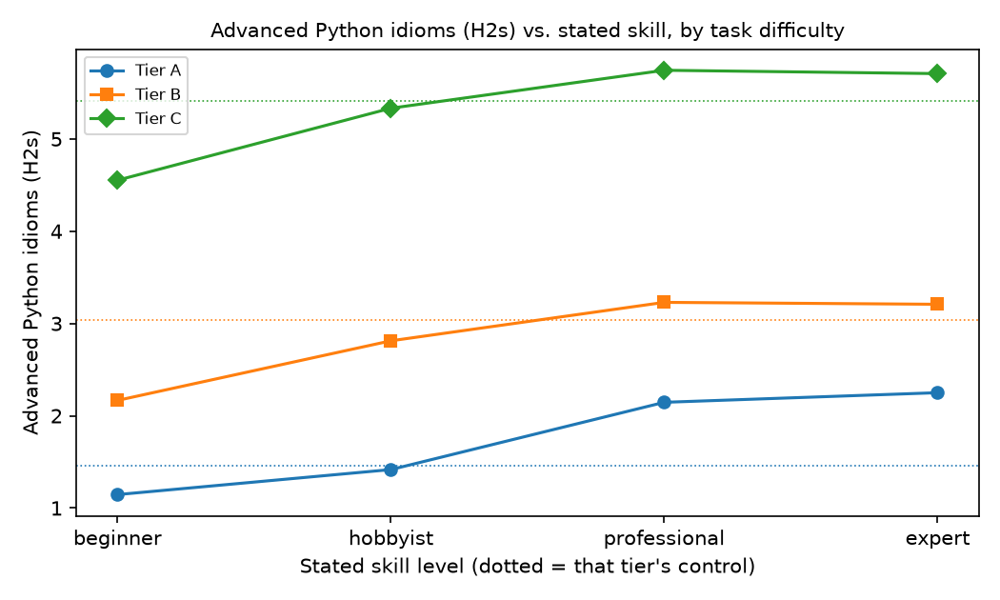

## Significance flips relative to the all-tasks estimate

- **Prose words around the code (H1s)** — `Tier A only (entry-level)`: effect +11.5000 [+1.4583, +23.0000], p=0.109 (all-tasks estimate was significant).
- **Prose words around the code (H1s)** — `Tier B only (intermediate)`: effect +8.6250 [-2.4375, +21.2292], p=0.25 (all-tasks estimate was significant).
- **Prose words around the code (H1s)** — `Not at ceiling, control < 0.95 (n=3 tasks)`: effect +28.8333 [-14.1667, +58.6667], p=0.5 (all-tasks estimate was significant).
- **Prose words around the code (H1s)** — `System-prompt channel only`: effect +5.3056 [-16.5417, +26.1806], p=0.577 (all-tasks estimate was significant).
- **Prose words around the code (H1s)** — `Hardening (security) tasks only`: effect +18.5000 [+3.3750, +34.0208], p=0.0781 (all-tasks estimate was significant).
- **Prose words around the code (H1s)** — `Replicate 2 only`: effect +26.2083 [+3.2500, +57.8333], p=0.0604 (all-tasks estimate was significant).
- **Prose words around the code (H1s)** — `Replicate 3 only`: effect +8.3125 [-12.9583, +27.9583], p=0.264 (all-tasks estimate was significant).
- **Advanced Python idioms (H2s)** — `Tier A only (entry-level)`: effect -1.1042 [-1.8542, -0.3333], p=0.0781 (all-tasks estimate was significant).
- **Advanced Python idioms (H2s)** — `Not at ceiling, control < 0.95 (n=3 tasks)`: effect -1.3000 [-2.9000, -0.3333], p=0.25 (all-tasks estimate was significant).
